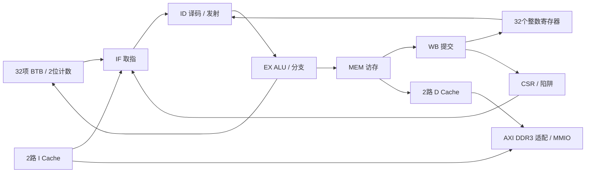

# 架构、指令、硬件与验证范围

## 数据通路

参考核心设置 `EXTRA_DECODE_STAGE=0`，采用五级单发射。译码/发射逻辑判断 RAW 依赖；EX、MEM、WB 结果旁路，尚未完成的 load 阻塞消费者。Cache/AXI 未完成请求保持流水线暂停。分支在 EX 计算真实下一 PC，并与取指时保存的预测下一 PC 比较；不一致才重定向和清空年轻指令。预测信息随指令及 skid buffer 保存，避免用已更新的 BTB 重算旧预测。CSR 陷阱重定向优先。

BTB 32 项直接映射，用 PC[6:2] 索引、完整 PC 标签，保存目标和 2 位饱和计数；命中且计数预测 taken 时选择目标。控制流执行后训练，未对齐目标不训练；FENCE.I 清理预测状态。`PREDICT_ENABLE=0` 可用于后续关闭预测的结果对照。

## 支持指令

| 类别 | 指令 |
|---|---|
| 上立即数/跳转 | LUI AUIPC JAL JALR |
| 分支 | BEQ BNE BLT BGE BLTU BGEU |
| 加载 | LB LH LW LBU LHU |
| 存储 | SB SH SW |
| 立即数运算 | ADDI SLTI SLTIU XORI ORI ANDI SLLI SRLI SRAI |
| 寄存器运算 | ADD SUB SLL SLT SLTU XOR SRL SRA OR AND |
| 基础系统 | FENCE ECALL EBREAK |
| 扩展 | FENCE.I；CSRRW CSRRS CSRRC CSRRWI CSRRSI CSRRCI；MRET |

不支持乘除法、压缩、原子、浮点指令。无硬件非对齐访问支持，按异常处理。CSR 未实现地址、对只读 CSR 的写入和不支持的返回指令应触发非法指令。

## Cache 与主存

I/D 分别为 2 路组相联：256 组，每行 32 字节，每路 8 KiB。地址偏移[4:0]，组[12:5]，其余为 tag。替换沿用参考核心的轮转状态，不宣称严格 LRU。D Cache 写回、写分配；脏行先 8 拍写回，再 8 拍回填。I Cache 只读回填；FENCE.I 参与同步和失效处理。两路 AXI 经整行适配、仲裁和 toggle CDC 连接板载 DDR3，主存范围 0x00000000–0x3FFFFFFF（1 GiB）。CPU/外设 50 MHz，控制器用户接口 100 MHz、256 位，DDR 时钟 400 MHz。Cache 的八个 32 位拍转换为一个 256 位控制器拍。MMIO 不缓存、不进行突发访问。具体接口与启动见 `ddr3-memory.md`。

PDS RAM 适配：D Cache CPU 端口的 `wr0_i` 在两处实例都固定为零，因此专门移除该端口无效写逻辑，保留另一端口写入与双端口同步读取；不是忽略有效写请求。

## 地址表

所有寄存器为 32 位、小端；主存 0x00000000–0x3FFFFFFF，复位 PC=0，栈顶 0x0000FF00。

| 地址 | 含义 |
|---|---|
| 80000000 | UART 数据：写发送，读接收并消费 |
| 80000004 | UART 状态：bit0 TX busy、bit1 RX valid、bit2 overrun |
| 80001000 | GPIO 输出；[15:8] 驱动八个 LED |
| 80001004 | GPIO 输入；[9:8] 为按下有效的 KEY2/KEY3 |
| 80001008 | GPIO 方向；[1:0] 为 J8 GPIO 输出使能 |
| 8000100C | GPIO 上升沿中断使能 |
| 80001010 | GPIO 中断 pending，写 1 清除 |
| 80002000 / 04 | 64 位 mtime 低/高字，按时钟递增 |
| 80002008 / 0C | 64 位 mtimecmp 低/高字 |
| 80002010 | 软件中断 msip |
| 80002014 | 测试用外部中断强制位 |
| 80002018 | 软件验收结果：1 成功，其他非零失败 |

UART RX 一个保持寄存器，不是 FIFO；软件需及时消费。输入采用两级同步，不含机械按键去抖。

## 陷阱/中断范围

M 模式 CSR 包括 mstatus、misa、mie、mip、mtvec、mscratch、mepc、mcause、mtval、mcycle/mcycleh、minstret/minstreth 及只读计数别名、mhartid。M 模式固定 MPP=3，MIE/MPIE 保存/恢复；MEPC 按 4 字节对齐。机器外部、软件、定时中断来自平台电平源；优先级外部 > 软件 > 定时。mtvec 支持直接入口与中断向量入口（base+4×cause）；同步异常使用 base。MRET 恢复使能及返回 PC。

测试源覆盖取指未对齐/访问错误、非法指令、断点、load/store 未对齐/访问错误、M ECALL，以及三种中断进入、源清除和返回。此处是实现与待验收范围，尚无执行证明。机器模式规范参见 [官方 RISC-V 文档](https://docs.riscv.org/reference/isa/priv/machine.html)。

## MES50HP 引脚

以本地 MES50HP 硬件手册为准，未沿用参考板约束。下表的基础 IO 使用 LVCMOS33；DDR3 IO 使用参考 IP 的 HSTL15_I / HSTL15D_I、1.5 V 配置，完整 DDR 引脚见 `mes50hp_ddr3.fdc`。

| 信号 | 管脚 |
|---|---|
| clk 50 MHz | P20 |
| rstn KEY1 | K18 |
| keys_n[0:1] KEY2/3 | L15、J17 |
| uart_rx / uart_tx | R8 / R9 |
| led[0:7] | B2、A2、B3、A3、C5、A5、F7、F8 |
| gpio[0:1] J8 第3/4脚 | AB13、Y13 |

时钟约束 20 ns；异步输入到首级同步器设 false path，内部同步路径仍计时。FINAL 没有 CPU JTAG 顶层时钟输入，之前 AB6 的 `GLOBAL_CLOCK Place-0084` 路径不存在。复位和 J8 使用共享管脚，PDS 可能提示 share pin；仍需结合板上配置模式验收。

## 后续验收

1. 逐项运行 42 个 rv32ui 与 3 个专项程序；保存每项 PASS/FAIL，而不是只判断固件能编译。
2. 运行 C demo，验证 UART 字符、计算值984、按键 LED 和串口回显。
3. 保存流水线波形；检查 load-use、旁路、分支与访存等待重叠。
4. Cache 同组不同 tag、脏替换、回填及字节写；观察 ARLEN/AWLEN=7 和8拍握手，统计停顿。
5. 分别开启/关闭预测并比较软件结果与误预测计数；执行陷阱/中断测试。

旧 `sim/soc_tb.sv` 中的片内 RAM 层次引用已不适用于 DDR3 顶层。用户要求不跑仿真，以上专项测试未执行，DDR3 版本也尚未上板。
