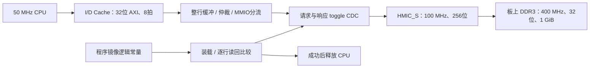

# FINAL DDR3 主存改动

## 主存与保留的片内存储

主存已改为 MES50HP 的两颗 4Gbit x16 DDR3，并联为 32 位，总容量 1 GiB，CPU 地址 `0x00000000–0x3FFFFFFF`。`final_bus.v` 不再声明主存 RAM 数组，也不再通过 `$readmemh` 初始化主存。18 块片内 DRM 全部用于 I/D Cache；DDR IP 内部缓冲使用 70 个分布式 RAM 资源，未使用 DRM。Cache 不是主存。CPU 栈和 C 程序数据均位于 DDR3。

## 来源与板卡适配

使用用户 D 盘竞赛资料的 `07_ddr3_test` 例程生成配置及 `ipsxb_hmic_s_v1_4_lite.iar`。IP 为 Logos HMIC_S 1.4，PGL50H、-6、FBG484，32 位，单 rank、BL8；参考例程输入时钟已经是 50 MHz。保留参考例程的 PHY 分组、PLL 位置、训练和 DDR 时序参数。Lite 包为 PDS 提供带 Pango 密钥的合法加密源，保持加密，不修改加密实现。

参考例程的可读顶层封装增加了控制器复位同步：PHY/PLL 启动仍用参考时钟，控制器复位在 100 MHz UI 时钟域经过两级同步后释放。总线桥也单独同步 DDR 域复位。约束豁免复位同步器的异步输入，以及 HMIC_S 在启动分频器、训练前使用的 DQS/IO 启动复位；这对应参考 IP 原来的异步时钟域定义，并限定到具体复位源和目标。其后控制器/总线桥的复位释放仍接受时序检查，普通数据路径没有被这些复位例外屏蔽。

`ddr3_test_ddrphy_top.v` 在 PHY 训练错误状态进入参考域复位/重训状态机之前加入两级电平同步。原训练算法和加密模块保持原样。

手册第 2.2.3 节和表 2-4：Bank B3、1.5 V，两颗 x16 4Gbit，15 行地址、10 列地址、3 bank 位。物理接口导出手册的 16 根地址线，其中 A15 对当前 4Gbit x16 几何固定为零。共有 72 个 DDR 物理信号，生成器将全部位置与手册转录表逐项对比，确保没有重复管脚。

IP 示例发出的 PGL50H 标准名为 `HSTL15_I` / `HSTL15D_I`，保留其官方 PHY 电平配置；没有把 1.5 V DDR 管脚设置为 LVCMOS33。普通 UART/LED/按键仍用本板原来的 3.3 V 约束，剔除了 DDR 示例的错误外围 1.2 V 配置。

控制器接口定义与地址格式参考 [官方 HMIC_S 用户指南](https://www.pangomicro.com/en/uploads/59186237_1711509831.pdf)，本机对应指南也在用户的竞赛资料包中。

## 总线处理

CPU 侧为 32 位 AXI，一条 Cache 行为 8 拍共 32 字节。HMIC_S 的一次 UI 传输为 256 位，UI `awlen/arlen=0` 表示一个 256 位拍，对应物理 DDR 的 BL8，不能照抄 CPU 的 AXI `len=7`。

写操作先完整收集 CPU 数据与逐字节 strobe，确认长度/最后拍后才发 DDR 请求。读操作先完整接收 256 位数据，再按 CPU `RREADY` 拆成 32 位拍；数据暂停时保持稳定。32 位单拍访存使用行内偏移与字节掩码。UI 地址是 DDR 字地址，使用 CPU 字节地址 `[29:2]` 并将低三位清零。非法、未对齐、越界和跨行异常请求返回 AXI 错误。

I/D 请求各有待处理槽位，读仲裁轮转；D 写数据完整后优先提交。每次最多一个 DDR UI 事务。CPU 与 UI 的时钟域通过双触发器同步请求/完成 toggle；多位请求和响应数据在整笔事务期间保持不变，使用受约束的 bundled-data 传递。

HMIC_S 没有原生 B 响应、写 valid 和读 ready。适配器在 IP `WREADY` 消费完整写数据后生成 CPU B 响应；这表示控制器接受了写入，硬件无法提供原生 DDR 总线错误检测。启动读回校验用于进一步检查实际写入和返回数据。UI 命令超时后报告错误并锁住通道，复位后才能恢复，防止迟到数据被当成下一笔响应。

## 上电与按键复位

1. FPGA 配置完成，CPU 保持复位。
2. DDR IP 执行上电初始化、write leveling、DQS gate 等训练。
3. `ddr_init_done` 同步到 CPU 时钟域。
4. 装载器将当前 `demo.bin` 的实际字节逐行写入 DDR3 地址零，每行立即读回比较；不是把整块 64 KiB DRM 搬进 FPGA。
5. 校验全部正确，释放 CPU。CPU 从 DDR3 地址零开始执行启动代码，建立 DDR3 中的栈并清零 BSS。
6. C 程序在低/高 DDR 地址写入不同值并读回，随后检查计算结果，继续按键、LED 和串口回显。

程序常量由 `generate_ddr_soc.py` 生成为 `firmware/boot_image.vh`，采用逻辑常量 case 查表，不是 CPU 可寻址 RAM，也不是主存。它随比特流保存，暂时不依赖尚未解决的 QSPI Flash 扫描问题。JTAG 临时下载和 QSPI 固化的区别依然存在。

状态 LED（位0对应 LED1）：

| 输出 | 含义 |
|---|---|
| 80 | 等待 DDR 初始化/校准 |
| 40 | 复制及读回校验程序镜像 |
| E0 | 装载/读回校验失败或命令超时，CPU 不启动 |
| E1 | C 程序 DDR 多地址检查失败 |
| 01 / A5 | 程序运行；无按键 / 任意按键按下 |

串口预期先出现 `FINAL DDR3: memory PASS`，再出现 `FINAL RV32I: C PASS`。按 KEY1 将复位 DDR 控制器并重新执行装载，等待阶段可能可见。

## 构建与验证边界

原片内主存版本保存在 `backups/BRAM_20261002/`。`build_all.ps1 -RunImplementation` 重建当前固件、程序常量、约束和 PDS 工程；日志为 `build/pds-ddr-build.log`。DDR IP 已本地导入 `ipcore/ddr3_test`，无须修改全局 PDS 安装。

按用户要求不运行仿真。之前已确认的串口、按键上板表现属于旧片内主存版本，不能作为本次 DDR 训练、读写或时序的证明。最终实现结果见 `build-status.md`。旧 `sim/soc_tb.sv` 直接引用 BRAM，当前版需要使用 DDR 模型重新接入，不能直接运行旧入口。
