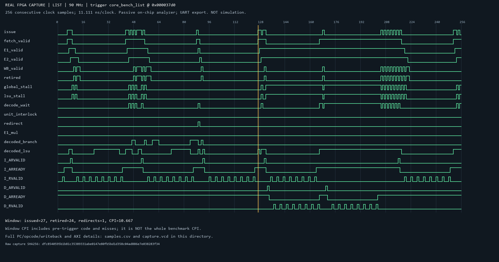
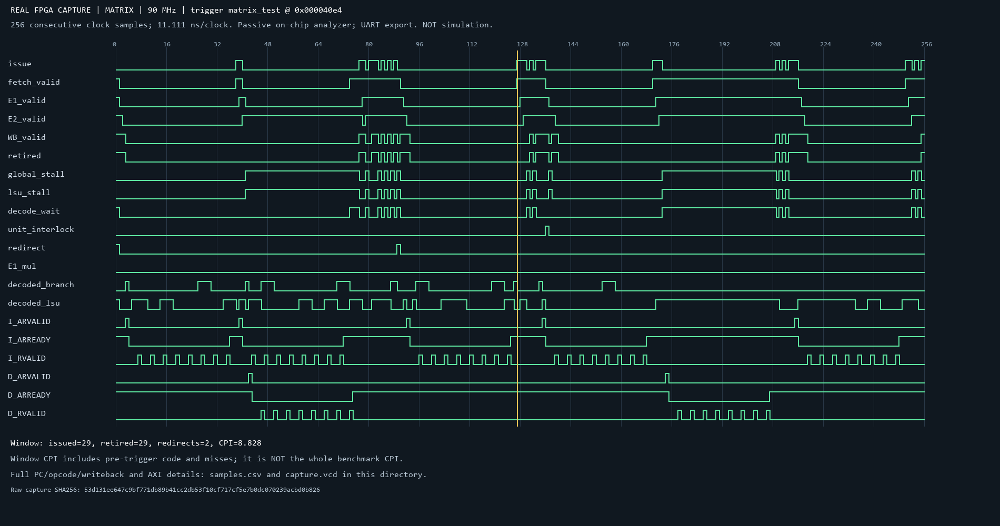
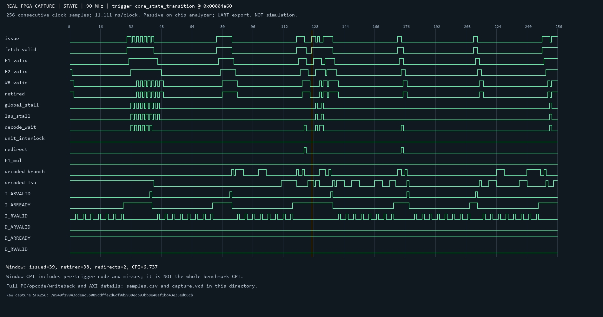
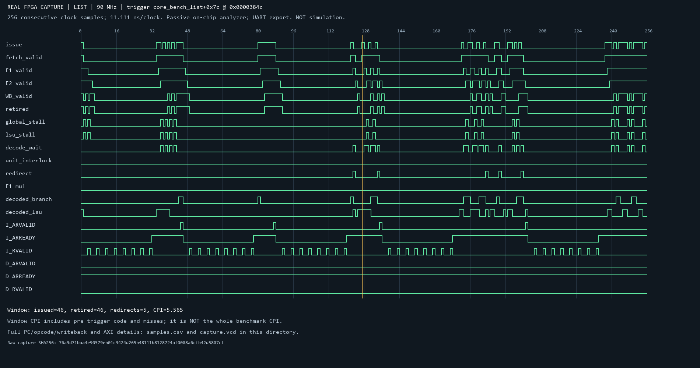
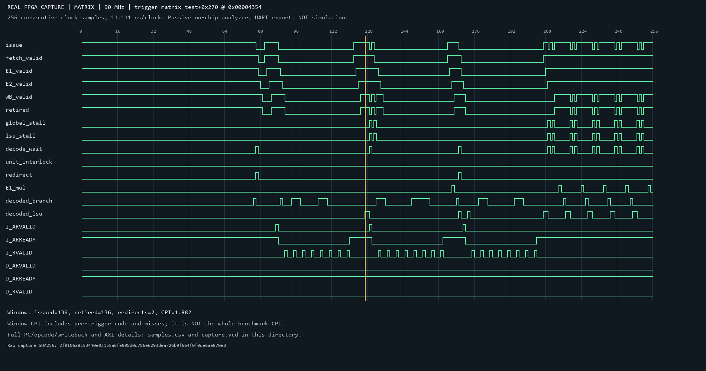
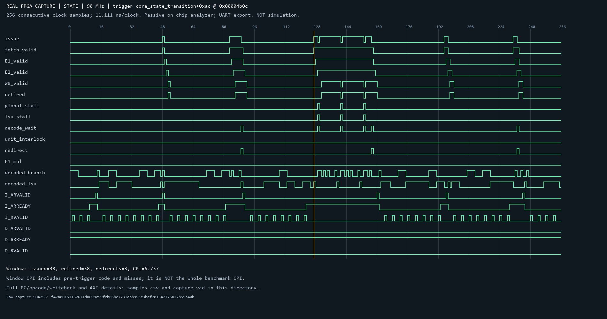

# CoreMark 实板片上波形与流水线分析

## 采集条件和数据口径

分析仪是工程内的 `cpu_validation_diag.v`：在FPGA实际CPU时钟下采样，只读观察CPU/AXI信号，以384位×256深度的循环RAM保存，再由板上CPU通过UART导出。不是RTL仿真，不是电脑生成的执行轨迹，也不是PDS原厂DebugCore工具。诊断配置为90MHz，最终多角时序+0.139ns，位流SHA前缀fa45ba747cb6。

每次按“发射有效且PC匹配”触发，保存触发附近256个连续周期，触发前约128周期、后约128周期。图中黄色竖线标记首次匹配的真实触发位置，后续同一PC的循环不会重新触发。采样周期11.111ns，整个窗口约2.844微秒。先导出物理RAM顺序的physical.bin，再根据写指针恢复时间顺序；VCD使用1ps时间单位，对90MHz周期逐点取整，避免累计误差。cycle计数可能自然32位回绕，解析按模2^32连续性检查。

每次抓取同时运行性能和验证两个种子，均3000次迭代、CRC正确、单次超过10秒。六个抓取任务对应12个有效运行。程序是链接到0x2000的独立CoreMark载荷，算法保持官方源码；正式计分位流与此诊断位流分开报告。

CPU观察点包括译码PC、opcode、E1/E2/WB的PC、写回结果、发射/退休/暂停/恢复状态；AXI观察点包括I/D地址、地址/数据握手、突发长度和错误响应。所有未列入PNG的字段仍可在CSV/VCD中查看。

流水边界为取指、译码缓冲、E1执行、E2结果/访存等待、WB提交；发射和操作数选择是组合控制，不将其另算一个时序级。E1/E2 valid在暂停时保持，不能直接当作“该周期退休”；效率以retired统计。

## 六个采样窗口

入口窗口用于说明函数进入时的缓存补行和栈访问。内循环窗口按实际反汇编选定PC，抓取链表指针查找、矩阵点积乘加、字符识别循环。后者是“定位到内循环的短窗口”，仍可能包含邻近代码和冷缺失，不声称都是完全暖机的稳态。

| 区域 | 算法 | 触发PC | 退休/周期 | 窗口CPI | LSU暂停周期 | 取指有效周期 | 重定向 | 实际发射MUL |
|---|---|---:|---:|---:|---:|---:|---:|---:|
| 入口 | list | 0x000037d0 | 24/256 | 10.667 | 90 | 79 | 1 | 0 |
| 入口 | matrix | 0x000040e4 | 29/256 | 8.828 | 84 | 80 | 2 | 0 |
| 入口 | state | 0x00004a60 | 38/256 | 6.737 | 11 | 51 | 2 | 0 |
| 内循环 | list | 0x0000384c | 46/256 | 5.565 | 18 | 72 | 5 | 0 |
| 内循环 | matrix | 0x00004354 | 136/256 | 1.882 | 12 | 149 | 2 | 6 |
| 内循环 | state | 0x00004b0c | 38/256 | 6.737 | 3 | 44 | 3 | 0 |

窗口CPI=256/窗口退休数。触发两侧可能有进入/离开窗口的在途指令，发射数不一定等于退休数。不能把这张表的局部CPI当作该算法完整运行的平均CPI。

## 代码与信号对应

链表内循环触发在`core_bench_list+0x7c`：

```text
0x3844 lw   a5,0(a5)       # 跟随next指针
0x3848 beqz a5,...
0x384c lw   a4,4(a5)       # 触发：读取节点数据指针
0x3850 lh   a2,2(a4)       # 立即依赖上一次加载结果
0x3854 bne  s10,a2,...     # 查找条件与控制流恢复
```

在该窗口中，指针链要求上次load的结果才能形成下次地址，存在不可简单并行的依赖。46条退休/256周期，LSU暂停18周期，fetch_valid只有72周期，重定向5次。因此该小段的空闲不能全部归为数据缓存；还包含取指等待和控制流变化。

矩阵内循环触发在`matrix_test+0x270`：

```text
0x4354 lh   a5,0(a3)       # 触发：矩阵元素A
0x4358 lh   a6,0(a2)       # 矩阵元素B
0x435c addi a4,a4,1
0x4360 addi a3,a3,2
0x4364 mul  a5,a5,a6       # RV32M乘法器，非LLM加速器
0x4368 add  a2,a2,s1
0x436c add  a0,a0,a5       # 乘积累加和结果依赖
0x4370 bltu a4,s0,0x4354
```

该窗口可观察到6次有效MUL发射及E1乘法标志，136条退休/256周期，CPI1.882，LSU暂停12周期、decode_wait13周期，重定向2次。指令安排中两次加载后有地址更新，乘法后有独立地址计算，这些指令帮助填充相关等待。没有增加M/F优化，也不把矩阵算法全部归为AI加速器完成。

状态机内循环触发在`core_state_transition+0xac`：

```text
0x4b0c lbu  a3,1(a5)       # 触发：读取下一个字符
0x4b10 addi a5,a5,1
0x4b14 beqz a3,...
0x4b18 li   a4,44
0x4b1c beq  a3,a4,...      # 逗号
0x4b20 li   a4,46
0x4b24 beq  a3,a4,...      # 小数点
...
0x4b34 bgeu a4,a3,0x4b0c  # 数字范围与状态变化
```

该窗口38条退休/256周期，LSU暂停仅3周期，但fetch_valid只有44周期、重定向3次。可据此判断这段采样的主要空窗不在乘除或数据访问，更多表现为前端供指和代码路径变化；不能仅看到分支多就推导出全程序预测准确率。

## 如何读图

- `issue=1`：当拍有指令进入执行；配合decode_pc/opcode定位代码。
- `fetch_valid=0`且issue=0：前端没有有效供指。结合I_ARVALID/I_RVALID判断缓存补行，不把所有空窗都称作“分支罚时”。
- `lsu_stall=1`：访存链路阻塞。若同时有D_AR握手与8个R数据握手，可对应32字节补行；信号保持期间E1/E2 valid也可能保持。
- `decode_wait`是fetch_valid且没有发射，原因可能包括数据相关、CSR/div等待、全局暂停等，它们存在交叠，不能直接相加当总停顿。
- `redirect`表示执行端发现预测下一PC不符；`csr_redirect`单列陷阱/FENCE返回等控制变化。
- `decoded_*`只是当前组合译码类别，必须用issue或有效位限定才能计为一条实际执行指令。只有看见E1_mul高电平不能在暂停窗口简单累计为乘法条数。
- AXI数据拍应按VALID和READY同时为1计数；不能只数VALID脉冲。RREADY在这些窗口基本持续有效。

## 完整测试窗口与短窗口的区别

诊断计数器对整个载荷（两组基准、初始化与串口格式输出）共统计2,539,547,896周期、1,801,774,280条退休指令，CPI约1.40947。它不是只包含某一个算法的ROI，也不是从256点窗口外推。三个入口抓取时这一完整载荷计数一致，说明被动采样没有在执行通路中增加握手或软件插桩。

正式版性能种子约14.027726秒、213.862178 CoreMark，验证种子约14.063996秒、213.310645，另以正式位流的原始日志为准。不能用短窗口CPI直接换算CoreMark或把诊断资源用作正式版CoreMark/LUT。

## 文件和复现

每个目录有report.json（位流、时钟、触发、载荷SHA与有效运行）、physical.bin（RAM物理顺序原始采样）、samples.csv（时间顺序）、capture.vcd、waveform.png。

在`validation/cpu90`下载时序合格诊断版后执行：

```powershell
python scripts/capture_coremark.py
python scripts/capture_coremark.py --region inner
python scripts/render_waveforms.py
python scripts/render_waveforms.py --region inner
```

内循环定位使用符号+偏移，并核对实际指令机器码；如果编译或布局变化导致机器码不符，脚本停止，必须重新依据反汇编选择，不能沿用旧PC。


### 入口：list

触发 `core_bench_list`，原始采样SHA256 `dfc8540595b1b81c35389331abe0147e80fb5bd1d358c04ad886e7e038283f34`。




### 入口：matrix

触发 `matrix_test`，原始采样SHA256 `53d131ee647c9bf771db89b41cc2db53f10cf717cf5e7b0dc070239acbd0b826`。




### 入口：state

触发 `core_state_transition`，原始采样SHA256 `7a949f19943cdeac5b089ddffe2d6df0d5939ecb93bb8e48af1bd43e33ed06cb`。




### 内循环：list

触发 `core_bench_list+0x7c`，原始采样SHA256 `76a9d71baa4e90579eb01c3424d265b48111b8128724af0008a6cfb42d5807cf`。




### 内循环：matrix

触发 `matrix_test+0x270`，原始采样SHA256 `2f9106a8c53440e03155a6fe908d0d786e6293dea726b9f664f0f0de6ae870e8`。




### 内循环：state

触发 `core_state_transition+0xac`，原始采样SHA256 `f47a80151162671da698c99fcb05be7731dbb953c3bdf781342776a22b55c40b`。


